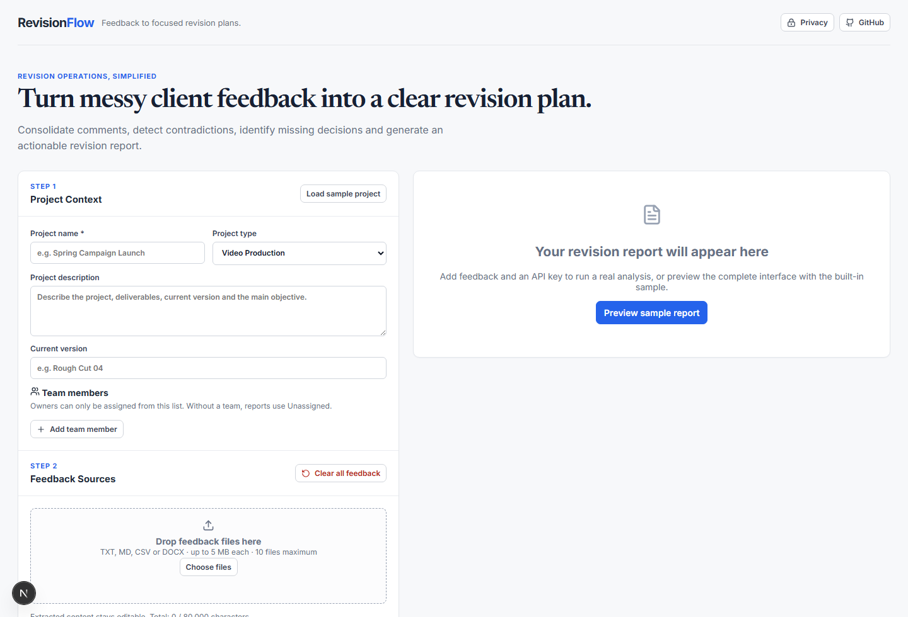
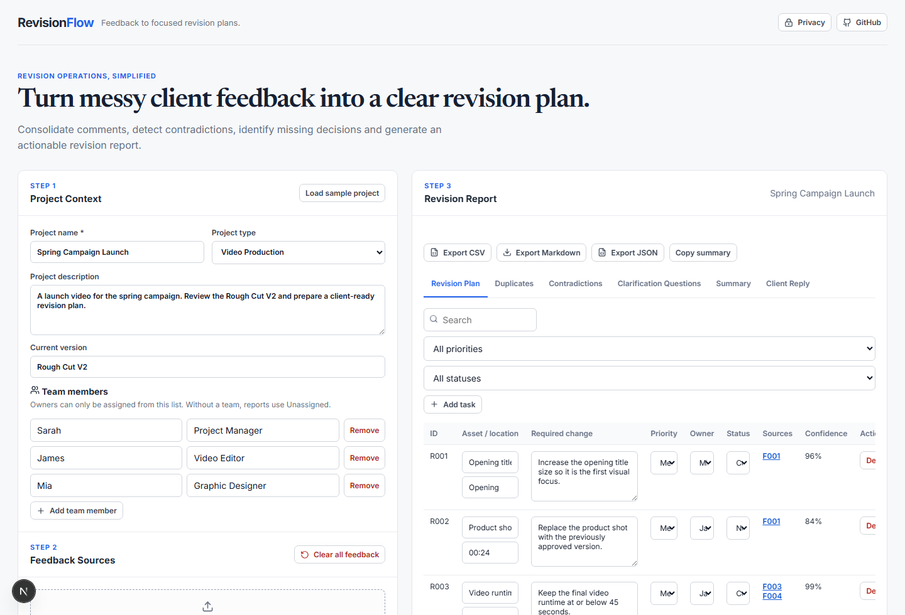

# RevisionFlow

[English](README.md) | [简体中文](README.zh-CN.md)

> An open-source MVP that turns scattered, duplicated, and contradictory client feedback into a traceable revision plan.

RevisionFlow is a focused single-page workspace for creative and delivery teams. Add project context, paste feedback or import files, then use your own OpenRouter key to generate a strict, editable report.

## Screenshots

### Workspace



### Sample report



## Quick demo

1. Run `npm install` and `npm run dev`.
2. Open `http://localhost:3000`.
3. Select **Load sample project**, then **Preview sample report**.
4. Explore the six report tabs, edit a revision item, and export CSV, Markdown, or JSON locally.

The sample report does not require an API key.

## Features

- Project context and an owner-safe team list
- Multiple editable feedback sources with stable `F001`-style identifiers
- Browser-side TXT, Markdown, CSV, and DOCX extraction
- OpenRouter Chat Completions integration with strict JSON Schema and server-side Zod validation
- Traceable revision items with source evidence
- Duplicate groups, contradictions, clarification questions, summary, and client reply
- Constrained editing for task priority, status, and owner
- Local CSV, Markdown, and JSON exports
- Built-in sample project and report

## How it works

1. Add project context and optional team members.
2. Paste feedback, add sources, or upload supported files.
3. Enter a current OpenRouter API key and a model that supports strict structured output.
4. Run analysis, then review, edit, trace, and export the report.

## Privacy model

There are no accounts, databases, cookies, browser storage, or saved project history. The API key remains only in current React state and is cleared on refresh. When analysis is requested, extracted project content and the key are sent through the server route to OpenRouter and the chosen model provider. Provider data policies apply.

## Supported file types

| Type          | Handling                                            |
| ------------- | --------------------------------------------------- |
| `.txt`, `.md` | Plain-text extraction                               |
| `.csv`        | Browser-side Papa Parse conversion to labelled rows |
| `.docx`       | Browser-side Mammoth raw-text extraction            |

Files are limited to 5 MB each, 10 files total, and 80,000 extracted characters across all feedback.

## Local installation

```bash
npm install
npm run dev
```

Open `http://localhost:3000`.

## OpenRouter API key and model

Use your own key in the workspace for the current analysis only. The verified default is `openai/gpt-4o-2024-08-06`, which OpenRouter currently lists with `response_format` and `structured_outputs` support. You may enter another compatible model; RevisionFlow never switches models silently.

## Development commands

```bash
npm run lint
npm run typecheck
npm run test
npm run test:e2e
npm run build
npm run start
```

## Deployment

RevisionFlow is a standard Next.js app and is ready for Vercel or another Node-compatible host. No environment variables are required because each user supplies an OpenRouter key per analysis. The host must permit outbound HTTPS requests to `openrouter.ai`.

## Limitations and roadmap

This is an open-source MVP, not a hosted collaboration platform. It intentionally has no accounts, persistence, team collaboration, PDFs/OCR/audio/video parsing, provider integrations, automated edits, or email sending.

Planned, but not included in v0.1.1:

- Gmail, Slack, and Frame.io integrations
- Jira, Trello, and Notion export
- Shared team projects and saved project history
- Client review portal and organisation templates

## Contributing

Issues and focused pull requests are welcome. Please run linting, type checks, and tests before opening a change.

## License

[MIT](LICENSE)

## Disclaimer

RevisionFlow organises supplied project feedback. It does not replace project judgment, client approval, or legal review.
